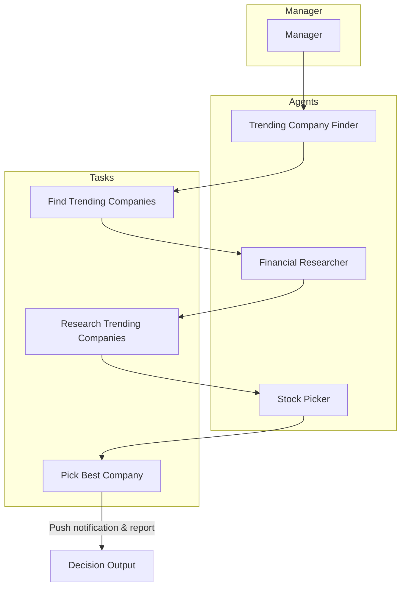

# Stock Picker 🚀

**Stock Picker** is a CrewAI‑based research assistant that automatically finds hot‑listed companies, analyses them, and selects the best investment candidate. It orchestrates three specialized agents – a news‑scraper, a financial researcher, and a decision maker – and delivers a concise push‑notification with the final recommendation.

---

## Why it matters
- **Time‑saving:** No manual web searches; the crew crawls news sources, extracts company data and produces a ready‑to‑act report.
- **Consistency:** The same workflow runs every day with up‑to‑date information.
- **Actionable output:** A push notification (via Pushover) delivers the decision instantly, followed by a detailed markdown report.

---

## How it works
The crew follows a **hierarchical** process managed by a `manager` agent. The workflow can be visualised below:



> **⚠️** Because this is a science‑visualisation task, the side‑car viewer will also expose a live diagram (click the `sidecar://` link that appears when the crew runs).

---

## Getting started
1. **Install the core dependencies**
   ```bash
   # Ensure you have Python 3.10‑3.13 and uv installed
   uv venv && source .venv/bin/activate
   uv add crewai crewai-tools requests
   ```
2. **Configure environment variables** for push notifications (Pushover)
   ```bash
   export PUSHOVER_USER="your_user_key"
   export PUSHOVER_TOKEN="your_app_token"
   ```
3. **Run the crew**
   ```bash
   python -m stock_picker.main   # defaults to sector=Technology, today’s date
   ```
   You can customise the sector:
   ```bash
   python -m stock_picker.main --sector Energy
   ```

---

## Extending the crew
- **Add new agents**: Create a new YAML entry in `config/agents.yaml` and an accompanying `@agent` method.
- **New tasks**: Define them in `config/tasks.yaml` and expose them via a `@task` method.
- **Alternative notification channels**: Replace `send_push_notification` with any HTTP‑based webhook; just keep the same `@tool` signature.

---

## Project structure (high‑level)
- `crew.py` – defines the `StockPicker` crew, agents, and tasks.
- `tools/push_tool.py` – the Pushover notification tool.
- `main.py` – convenience entry‑point that supplies default inputs.
- `config/*.yaml` – declarative definitions for agents and tasks.
- `output/` – generated JSON/markdown files after each run.

---

## Contributing
1. Fork the repository.
2. Run tests (if any) with `uv run pytest`.
3. Submit a PR with a clear description of the added feature or bug‑fix.

---

